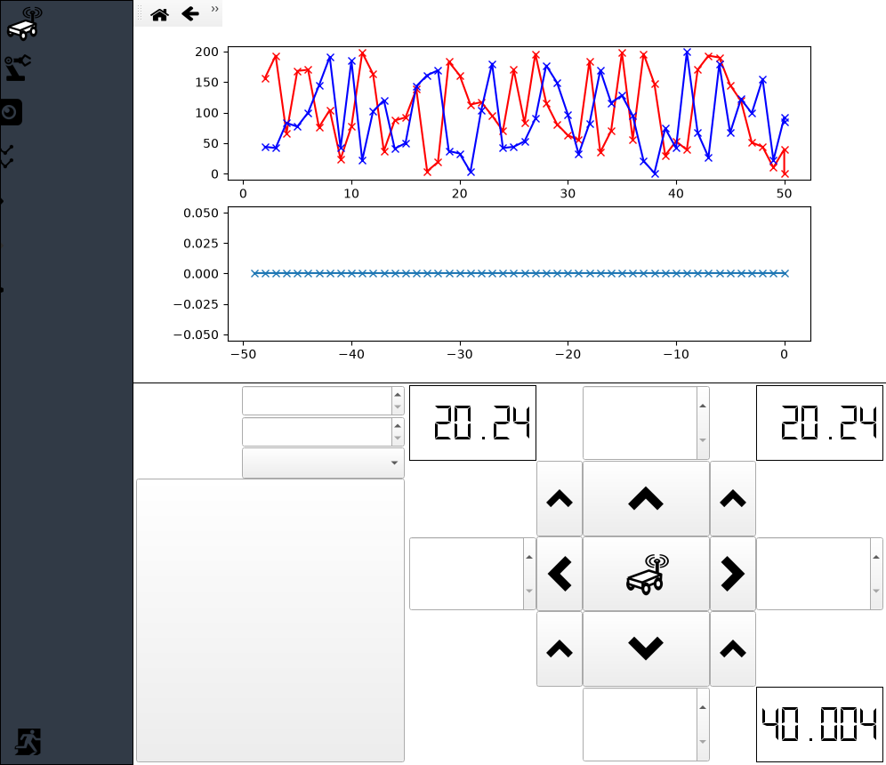
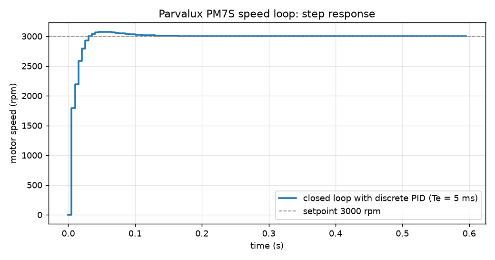
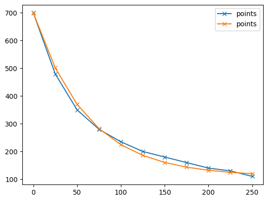

# Robot mobile – STM32, FreeRTOS, micro-ROS et ROS 2

*[English version](README.md)*

Robot mobile à deux roues motrices, réalisé pour le module de systèmes embarqués (SEN) de l'ENIB, au printemps 2024.

Une **STM32 Nucleo-F411RE** fait tourner **FreeRTOS** et **micro-ROS**. Elle pilote deux moteurs à courant continu Parvalux PM7S avec une **boucle de vitesse PID** numérique, lit des capteurs de distance infrarouges et à temps de vol pour réagir aux obstacles, et communique avec un PC via **ROS 2**. Sur le PC, une **IHM PyQt5** (nœud ROS 2 Humble) affiche les capteurs, les courbes de vitesse et la caméra, et envoie les commandes depuis des boutons ou une manette Xbox.



## Fonctionnalités

**Firmware (STM32F411, FreeRTOS)**
- **Asservissement de vitesse** : un PID par roue, échantillonné toutes les 5 ms, à partir des codeurs incrémentaux (`pidFilter.c`, `quadEncoder.c`, `motorCommand.c`).
- **Réaction aux obstacles** : un capteur à temps de vol VL53L0X (I²C) à l'arrière et deux capteurs IR (ADC) à l'avant. Quand un obstacle est trop proche, une tâche envoie une correction dans une file et les moteurs reculent ou avancent pendant 100 ms.
- **Modes de fonctionnement** : aléatoire, ligne et télécommandé. Le mode courant s'affiche sur un écran LCD Grove 16x2.
- **Nœud micro-ROS** `STM32_Node` sur l'UART1 avec DMA : il publie `/sensor/dist_back` et s'abonne à `/command/move`. Le `ROS_DOMAIN_ID` est propre à chaque robot.
- Au démarrage, chaque roue tourne jusqu'au premier signal d'index du codeur, pour partir d'une position connue.

**IHM PC (ROS 2 Humble, PyQt5)**
- Croix directionnelle, consignes de vitesse par moteur, choix du mode.
- Courbes matplotlib en direct de la vitesse des moteurs et du robot, et console Python intégrée.
- Flux caméra brut reçu sur `camera/src_frame` (`sensor_msgs/Image`).
- Pilotage à la manette Xbox avec la bibliothèque `inputs`.

**Notebooks de conception**
- `SIM_Moteurs_Parvalux.ipynb` : modèle du moteur, discrétisation par bloqueur d'ordre zéro à 5 ms, réglage du PID sur l'abaque de Black-Nichols (Kp = 0,039, Ki = 0,005, Kd = 0,01).
- `reflexions.ipynb` : étalonnage des capteurs IR, ajusté en `distance (mm) = 590·exp(−0,0164·ADC) + 110`.
- `test_serial_pyserial.ipynb` : tests de la liaison série avec la carte.

| Réponse indicielle avec PID (modèle du moteur) | Étalonnage du capteur IR |
|---|---|
|  |  |

## Matériel

| Composant | Rôle |
|---|---|
| STM32 Nucleo-F411RE | Contrôleur principal (FreeRTOS + micro-ROS) |
| 2 moteurs CC Parvalux PM7S + pont en H | Propulsion |
| Codeurs incrémentaux | Mesure de la vitesse des roues |
| VL53L0X (I²C) | Capteur de distance à temps de vol, à l'arrière |
| 2 capteurs IR analogiques | Détection d'obstacles à l'avant |
| LCD Grove 16x2 (I²C) | Affichage du mode |

Le brochage est dans [`docs/brochage.ods`](docs/brochage.ods).

## Organisation du dépôt

```
firmware/base_robot/     projet STM32CubeIDE (Core/, .ioc, FreeRTOS, utilitaires micro-ROS)
ros2_ws/src/py_ihm/      paquet ROS 2 : IHM PyQt5
notebooks/               modèle du moteur et réglage du PID, étalonnage IR, tests série
docs/                    brochage, objectifs du projet, figures
```

## Démarrage

**Firmware**
1. Ouvrir `firmware/` comme workspace dans STM32CubeIDE et importer `base_robot`.
2. La bibliothèque statique micro-ROS est construite par l'étape de pré-compilation de `micro_ros_stm32cubemx_utils`, qui nécessite Docker.
3. Compiler et flasher la carte Nucleo. Les traces de debug sortent sur l'USART2 : `minicom -D /dev/ttyACM0`.

**IHM** (Ubuntu 22.04, ROS 2 Humble)
```bash
pip install PyQt5 pyqtconsole matplotlib inputs pyserial
cd ros2_ws
colcon build
source install/setup.bash
ros2 run py_ihm ihm_ros2
```
Un agent micro-ROS doit tourner sur le PC pour relier la carte à ROS 2.

**Régénérer la figure de réponse indicielle**
```bash
pip install control matplotlib numpy scipy
python notebooks/plot_step_response.py docs/img/pid_step_response.png
```

## Crédits

Projet d'équipe, module SEN de l'ENIB, printemps 2024. Le filtre PID a été écrit par [m0madec](https://git.enib.fr/m0madec), et le dépôt d'origine de l'équipe est hébergé sur git.enib.fr. Le squelette du paquet ROS 2 et le projet FreeRTOS de base ont été fournis par l'équipe pédagogique de l'ENIB.

Le code tiers garde sa propre licence : HAL STM32 (BSD-3-Clause), FreeRTOS (MIT), micro-ROS (Apache-2.0).
