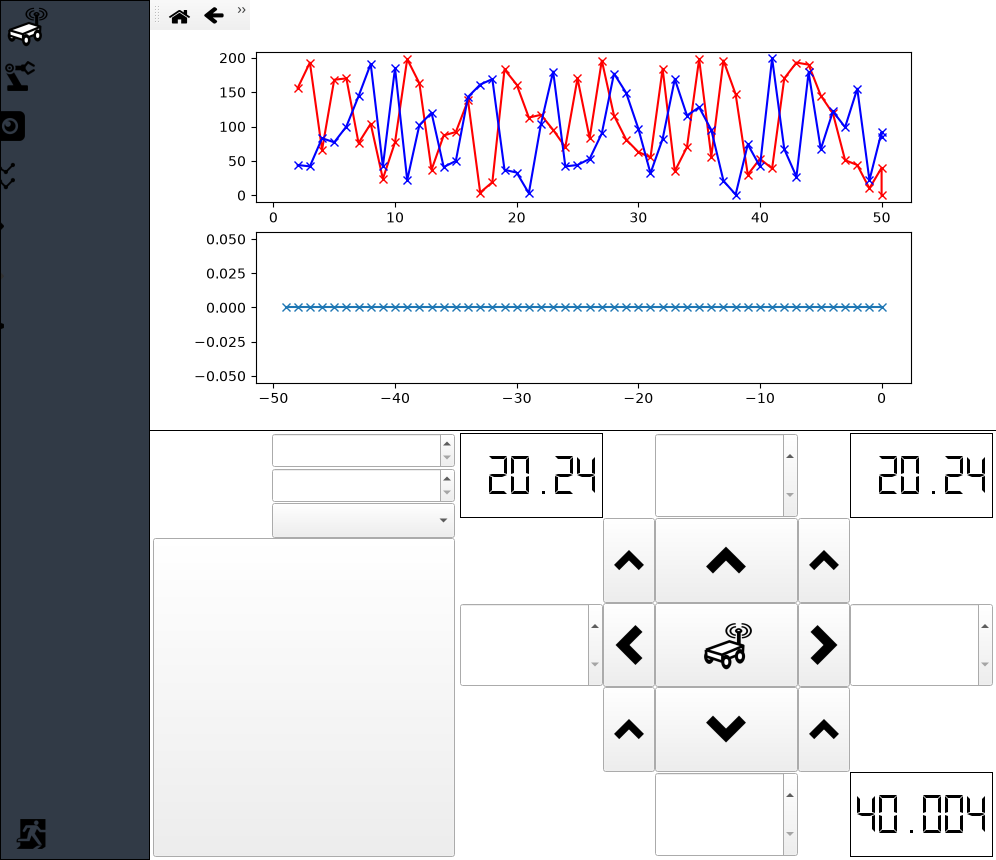
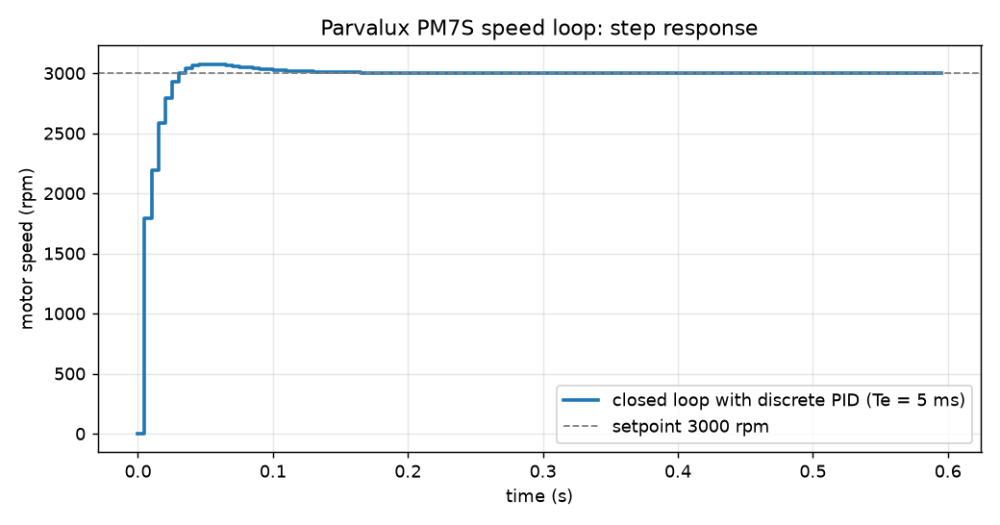
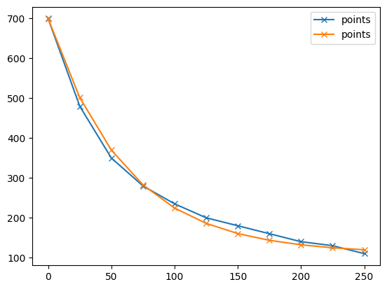

# Mobile Robot – STM32, FreeRTOS, micro-ROS and ROS 2

*[Version française](README.fr.md)*

Differential-drive mobile robot built for the embedded systems module (SEN) at ENIB, spring 2024.

An **STM32 Nucleo-F411RE** runs **FreeRTOS** and **micro-ROS**. It drives two Parvalux PM7S DC motors with a discrete **PID speed loop**, reads infrared and time-of-flight distance sensors to react to obstacles, and talks to a PC over **ROS 2**. On the PC, a **PyQt5 control panel** (a ROS 2 Humble node) shows the sensor values, speed graphs and camera feed, and sends commands from on-screen buttons or an Xbox controller.



## Features

**Firmware (STM32F411, FreeRTOS)**
- **Speed control**: one PID per wheel, sampled every 5 ms, fed by quadrature encoders (`pidFilter.c`, `quadEncoder.c`, `motorCommand.c`).
- **Obstacle reaction**: a VL53L0X time-of-flight sensor (I²C) at the back and two IR sensors (ADC) at the front. When an obstacle comes too close, a task posts a correction to a queue and the motors back off or push forward for 100 ms.
- **Operating modes**: random, line and remote-controlled. The current mode is shown on a Grove 16x2 LCD.
- **micro-ROS node** `STM32_Node` over UART1 with DMA: it publishes `/sensor/dist_back` and subscribes to `/command/move`. `ROS_DOMAIN_ID` is set per robot.
- On start-up, each wheel turns until the first encoder index pulse is reached, so the encoders start from a known position.

**PC control panel (ROS 2 Humble, PyQt5)**
- Direction pad, per-motor speed set points, mode selection.
- Live matplotlib graphs of motor and robot speed, plus an embedded Python console.
- Raw camera feed subscribed from `camera/src_frame` (`sensor_msgs/Image`).
- Xbox controller input via the `inputs` library.

**Design notebooks**
- `SIM_Moteurs_Parvalux.ipynb`: DC motor model, zero-order-hold discretisation at 5 ms, PID tuning on the Nichols chart (Kp = 0.039, Ki = 0.005, Kd = 0.01).
- `reflexions.ipynb`: IR sensor calibration fitted as `distance (mm) = 590·exp(−0.0164·ADC) + 110`.
- `test_serial_pyserial.ipynb`: serial link tests with the board.

| PID step response (from the motor model) | IR sensor calibration |
|---|---|
|  |  |

## Hardware

| Part | Role |
|---|---|
| STM32 Nucleo-F411RE | Main controller (FreeRTOS + micro-ROS) |
| 2 × Parvalux PM7S DC motors + H-bridge | Propulsion |
| Quadrature encoders | Wheel speed measurement |
| VL53L0X (I²C) | Rear time-of-flight distance sensor |
| 2 × analog IR sensors | Front obstacle detection |
| Grove LCD 16x2 (I²C) | Mode display |

The pin mapping is in [`docs/brochage.ods`](docs/brochage.ods).

## Repository layout

```
firmware/base_robot/     STM32CubeIDE project (Core/, .ioc, FreeRTOS, micro-ROS utils)
ros2_ws/src/py_ihm/      ROS 2 package: PyQt5 control panel
notebooks/               motor model and PID design, IR calibration, serial tests
docs/                    pin mapping, project goals, figures
```

## Getting started

**Firmware**
1. Open `firmware/` as a workspace in STM32CubeIDE and import `base_robot`.
2. The micro-ROS static library is built by the `micro_ros_stm32cubemx_utils` pre-build step, which needs Docker.
3. Build and flash the Nucleo board. The debug output is on USART2: `minicom -D /dev/ttyACM0`.

**Control panel** (Ubuntu 22.04, ROS 2 Humble)
```bash
pip install PyQt5 pyqtconsole matplotlib inputs pyserial
cd ros2_ws
colcon build
source install/setup.bash
ros2 run py_ihm ihm_ros2
```
A micro-ROS agent must run on the host to bridge the board to ROS 2.

**Regenerate the step response figure**
```bash
pip install control matplotlib numpy scipy
python notebooks/plot_step_response.py docs/img/pid_step_response.png
```

## Credits

Team project, ENIB SEN module, spring 2024. The PID filter was written by [m0madec](https://git.enib.fr/m0madec), and the team's original repository is hosted on git.enib.fr. The ROS 2 package skeleton and the FreeRTOS base project were provided by the ENIB teaching staff.

Third-party code keeps its own licence: STM32 HAL (BSD-3-Clause), FreeRTOS (MIT), micro-ROS (Apache-2.0).
